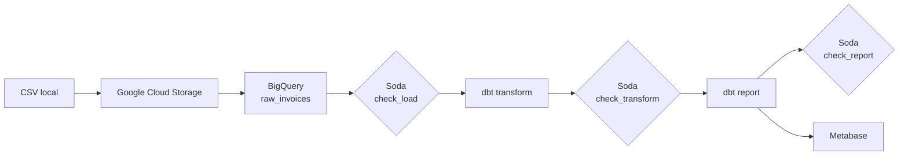
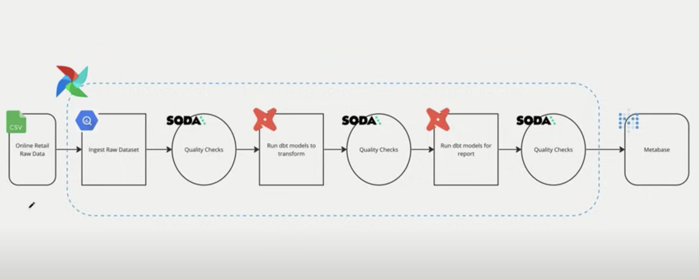

# 🛒 Retail Data Pipeline

Pipeline de données end-to-end pour l'analyse de ventes e-commerce : ingestion dans le cloud, contrôles qualité, modélisation analytique et tableau de bord, le tout orchestré avec **Apache Airflow**.

## 🎯 Objectif

Transformer un fichier brut de transactions retail (CSV) en tables analytiques fiables et exploitables dans un outil de BI, en automatisant chaque étape et en vérifiant la qualité des données tout au long du flux.

## 🏗️ Architecture



## 🧰 Stack technique

| Domaine | Outils |
|---|---|
| Orchestration | Apache Airflow, Astro CLI / Astro Runtime |
| Stockage & Data Warehouse | Google Cloud Storage, BigQuery |
| Ingestion | Astro SDK |
| Transformation | dbt (dbt-bigquery), Cosmos |
| Qualité des données | Soda Core |
| Visualisation | Metabase |
| Infrastructure | Docker, Docker Compose |
| Langages | Python, SQL |

## 📁 Structure du projet

```
├── dags/
│   └── retail.py              # DAG principal
├── include/
│   ├── dataset/               # Données sources (CSV)
│   ├── dbt/                   # Projet dbt (transform / report)
│   ├── soda/                  # Configuration et checks Soda
│   └── metabase-data/         # Données Metabase
├── tests/                     # Tests d'intégrité des DAGs
├── Dockerfile                 # Runtime Airflow + venvs isolés (Soda, dbt)
├── docker-compose.override.yml# Service Metabase
├── requirements.txt
└── packages.txt
```

## ⚙️ Fonctionnement du DAG

| Étape | Description |
|---|---|
| `upload_csv_to_gcs` | Envoi du CSV vers un bucket GCS |
| `create_retail_dataset` | Création du dataset BigQuery |
| `gcs_to_raw` | Chargement dans la table `raw_invoices` |
| `check_load` | Contrôles Soda sur les données brutes |
| `transform` | Modèles dbt de transformation |
| `check_transform` | Contrôles Soda après transformation |
| `report` | Modèles dbt de reporting |
| `check_report` | Contrôles Soda finaux |

**Choix techniques :**
- Soda et dbt sont installés dans des **environnements virtuels séparés** et appelés via `@task.external_python`, pour éviter les conflits de dépendances avec Airflow.
- Les modèles dbt sont exécutés comme des **task groups Airflow** grâce à Cosmos, ce qui donne une visibilité modèle par modèle dans l'UI.
- Un contrôle qualité est placé **après chaque couche** du pipeline.

## 🚀 Installation

### Prérequis
- Docker et Docker Compose
- Astro CLI
- Un projet Google Cloud avec BigQuery et Cloud Storage activés
- Un compte de service GCP (clé JSON)

### Lancement

```bash
git clone <url-de-ton-repo>
cd <nom-du-repo>
```

1. Placer la clé du compte de service dans `include/gcp/service_account.json`.
2. Adapter dans `dags/retail.py` le nom du bucket GCS.
3. Démarrer l'environnement :

```bash
astro dev start
```

4. Dans l'UI Airflow (`localhost:8080`), créer la connexion **`gcp`** (type Google Cloud) avec la clé du compte de service.
5. Lancer le DAG `retail`.
6. Ouvrir Metabase sur `localhost:3000` et connecter BigQuery.

## 📊 Résultats

### Modèle de données


### Dashboard Metabase


### DAG Airflow


## 🔮 Améliorations possibles
- Planifier le DAG (actuellement déclenché manuellement)
- Ajouter des alertes (Slack / email) en cas d'échec des contrôles Soda
- Déployer sur un Airflow managé
- Ajouter une CI pour les tests de DAGs et `dbt test`

## 📄 Licence
MIT
